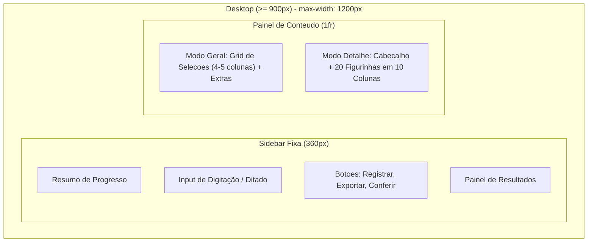

# Plano de Implementação: Interface Desktop, Tipografia Apple e Sombras Minimalistas

> **Para executores agenticos:** SUB-SKILL REQUERIDA: Use `superpowers:subagent-driven-development` ou `superpowers:executing-plans` para implementar este plano passo a passo com commits e testes.

**Meta:** Adaptar a interface do álbum de figurinhas da Copa 2026 para computadores com layout em 2 colunas (sidebar adesiva de registro + grade ampla de conteúdo), incorporar a tipografia oficial da Apple (SF Pro) e aplicar um sistema de elevação e sombras minimalistas.

**Arquitetura:** 
1. **Layout Responsivo:** No mobile (<900px), mantém a experiência em coluna única; no desktop (≥900px), o container se expande até 1200px com layout em 2 colunas (`360px` para sidebar fixa e `1fr` para conteúdo). Ao abrir o detalhe de uma seleção no desktop, o painel de registro permanece acessível à esquerda e a área direita exibe a grade da seleção em 10 colunas (20 figurinhas em 2 linhas de 10).
2. **Tipografia Apple:** Importação da web font SF Pro via CDN no `index.html`, com suavização de renderização (`-webkit-font-smoothing`), tracking sutil (`-0.015em`) e escala de pesos hierárquica.
3. **Elevação & Sombras Minimalistas:** Paleta de sombras difusas em camadas (`box-shadow`), substituindo bordas rígidas por profundidade tátil e transições refinadas de hover e foco.

**Tech Stack:** HTML5 semântico, Vanilla JavaScript (ES Modules), CSS3 (CSS Grid, Flexbox, Custom Properties, Media Queries).

---

## Estrutura do Layout



---

## Tarefas de Implementação

### Tarefa 1: Atualização Estrutural do HTML e Importação da Fonte SF Pro

**Arquivos:**
- Modificar: `index.html`

**Mudanças detalhadas:**
1. Importar a folha de estilo da fonte SF Pro Display / Text via CDN no `<head>`.
2. Reorganizar semanticamente o `<main>` introduzindo `<main class="main-layout">`:
   - `<aside class="sidebar-panel">` contendo o `<section class="register-panel">`.
   - `<div class="content-panel">` contendo `<section id="homeView">` (com os cards das seleções e extras) e `<section id="detailView">` (com cabeçalho e grade de figurinhas).

- [ ] **Passo 1.1: Editar `index.html`**
Adicionar a fonte no `<head>`:
```html
<link rel="stylesheet" href="https://fonts.cdnfonts.com/css/sf-pro-display" />
```
Reestruturar o `<main>` mantendo todos os `id`s e `class`es intactos para garantir 100% de compatibilidade com os scripts.

- [ ] **Passo 1.2: Validar integridade dos testes**
Executar: `npm test`
Esperado: 150/150 testes passando.

- [ ] **Passo 1.3: Commit da Tarefa 1**
```bash
git add index.html
git commit -m "feat: reestruturar layout semantico para desktop e importar fonte SF Pro"
```

---

### Tarefa 2: Ajustes de Visibilidade Responsiva no JavaScript

**Arquivos:**
- Modificar: `src/js/app.js`

**Mudanças detalhadas:**
No `app.js`, a função `render()` atualmente oculta `homeView` quando `showingDetail` é verdadeiro.
Precisamos apenas sinalizar o estado no `document.body` (ex: `document.body.classList.toggle("showing-detail", showingDetail);`) para que o CSS controle a visibilidade da barra lateral no mobile (ocultando-a para dar foco total ao álbum quando em telas pequenas) enquanto no desktop a barra lateral permanece perfeitamente visível.

- [ ] **Passo 2.1: Modificar `src/js/app.js`**
Na função `render()`:
```javascript
function render() {
  const showingDetail = Boolean(selectedSectionId);
  elements.homeView.hidden = showingDetail;
  elements.detailView.hidden = !showingDetail;
  document.body.classList.toggle("showing-detail", showingDetail);
  renderProgress();
  renderSectionCards();
  if (showingDetail) renderDetail();
}
```

- [ ] **Passo 2.2: Validar integridade dos testes**
Executar: `npm test`
Esperado: PASS (150 testes).

- [ ] **Passo 2.3: Commit da Tarefa 2**
```bash
git add src/js/app.js
git commit -m "feat: adicionar classe showing-detail ao body para controle responsivo"
```

---

### Tarefa 3: Estilização CSS: Tipografia Apple, Sombras e Layout 2 Colunas

**Arquivos:**
- Modificar: `src/styles.css`

**Mudanças detalhadas:**
1. **Variáveis e Tipografia Apple:**
   - Declarar `--font-apple: "SF Pro Display", "SF Pro Text", -apple-system, BlinkMacSystemFont, "Helvetica Neue", Helvetica, Arial, sans-serif;`.
   - Adicionar regras de renderização: `-webkit-font-smoothing: antialiased; -moz-osx-font-smoothing: grayscale; text-rendering: optimizeLegibility;`.
   - Ajustar `letter-spacing: -0.015em` e pesos de fonte refinados (400, 500, 600, 700).
2. **Sistema de Sombras Minimalistas:**
   - `--shadow-card`: `0 2px 8px -2px rgba(0, 0, 0, 0.04), 0 6px 16px -4px rgba(0, 0, 0, 0.03)`
   - `--shadow-card-hover`: `0 6px 20px -2px rgba(0, 0, 0, 0.07), 0 12px 28px -4px rgba(0, 0, 0, 0.05)` com elevação `transform: translateY(-2px)`
   - `--shadow-panel`: `0 4px 20px -2px rgba(0, 0, 0, 0.05), 0 12px 32px -4px rgba(0, 0, 0, 0.04)`
   - `--shadow-btn-primary`: `0 2px 8px rgba(22, 101, 52, 0.22)`
   - `--shadow-sticker-owned`: `0 3px 10px rgba(22, 101, 52, 0.28)`
   - Suaves `box-shadow` internas nos inputs e textareas.
3. **Grid & Responsividade para Desktop:**
   - `.app-shell`: aumentar largura máxima para `min(100%, 1240px)`.
   - Media query `min-width: 900px`:
     - `.main-layout`: `display: grid; grid-template-columns: 360px 1fr; gap: 36px; align-items: start;`.
     - `.sidebar-panel`: `position: sticky; top: 24px;`.
     - `.section-cards`: `grid-template-columns: repeat(auto-fill, minmax(160px, 1fr)); gap: 14px;`.
     - `.sticker-grid`: `grid-template-columns: repeat(10, minmax(0, 1fr)); gap: 12px;` (exibição de 20 figurinhas em 2 linhas de 10).
   - Media query `max-width: 899px`:
     - `body.showing-detail .sidebar-panel { display: none; }` (foco total na figurinha no celular).

- [ ] **Passo 3.1: Implementar os estilos no `src/styles.css`**
Atualizar `src/styles.css` com formatação limpa e organizada.

- [ ] **Passo 3.2: Rodar testes e build**
Executar: `npm test` e `npm run build`
Esperado: 150 testes passando e `dist/` gerado com sucesso.

- [ ] **Passo 3.3: Commit da Tarefa 3**
```bash
git add src/styles.css
git commit -m "feat: implementar layout desktop em 2 colunas, tipografia Apple e sombras minimalistas"
```

---

## Plano de Verificação

### Testes Automatizados
- `npm test`: Executa todos os 150 testes de unidade (registro de figurinhas, parser de linguagem natural, conferência de listas, cálculo de progresso e exportação WhatsApp).
- `npm run build`: Verifica empacotamento completo para `dist/`.

### Verificação Manual
1. **Desktop (Resolução ≥ 1024px):**
   - Abrir o app no navegador.
   - Observar a divisão em 2 colunas: o painel de registro permanece adesivo à esquerda ao rolar a página.
   - Conferir que as seleções ocupam a coluna direita em grade elegante.
   - Clicar em uma seleção (ex: Brasil): a grade exibe 20 números perfeitamente alinhados em 10 colunas (2 linhas de 10).
   - Digitar "Brasil 10" no campo de comando da coluna esquerda: verificar que a figurinha 10 é marcada instantaneamente no detalhe à direita e o progresso é atualizado.
2. **Mobile (Resolução < 600px):**
   - Simular celular nas ferramentas de desenvolvedor (F12).
   - Conferir que a visualização inicial permanece em coluna única.
   - Clicar em uma seleção e verificar que a tela foca na seleção com botão de voltar.
3. **Tipografia e Sombras:**
   - Avaliar a fonte SF Pro (clareza, elegância, peso equilibrado e tracking Apple).
   - Avaliar a sutileza das sombras em cards, inputs e botões, mantendo o aspecto limpo e moderno.
